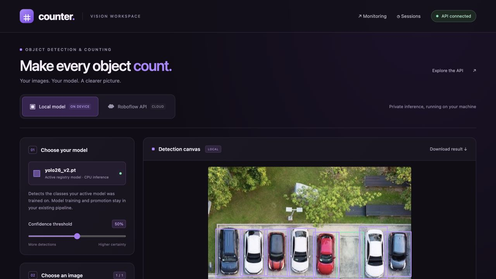
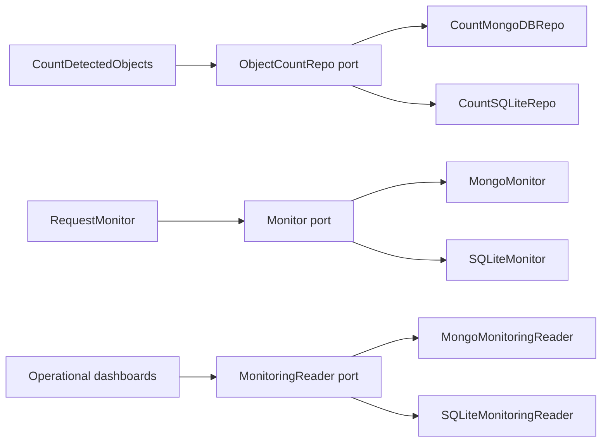
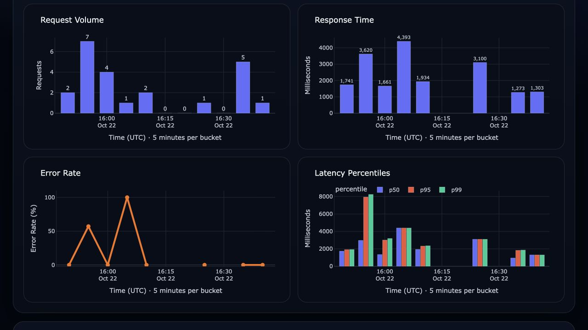

# Object Detection & Counter MLOps

**An image detection and counting workspace with local YOLO and bring-your-own Roboflow inference, interactive bounding boxes, batches, persistent session counts, and operational dashboards. Built around replaceable detection and storage adapters.**

[](https://github.com/joshuadominic0598/object-detection-counter-mlops-architecture/actions/workflows/app-tests.yml)
[](https://www.python.org/)
[](https://fastapi.tiangolo.com/)
[](https://www.ultralytics.com/)
[](https://www.mongodb.com/)
[](https://www.sqlite.org/)
[](https://www.docker.com/)
[](https://pytest.org/)
[](#architecture)

[🖥️ The App](#-the-app) • [🏗️ Architecture](#-architecture) • [🚀 Quick Start](#-quick-start) • [🧩 Make It Yours](#-make-it-yours) • [📁 Project Structure](#-project-structure) • [📡 API](#-api) • [🤖 Model Training, Registry and Performance](#-model-training-registry-and-performance) • [🩺 Monitoring](#-monitoring) • [🧪 App Tests](#-app-tests)

---

## 🖥️ The App

**Choose a model, drop in an image, and inspect what it finds.** The browser workspace brings inference, visual inspection, counting, and monitoring together, so trying the app starts with `make start` and a browser.

[](resources/readme/app-workspace.png)

*Actual app screenshot: the local parking model finds 8 objects in an included sample. Results depend on the chosen model, image, and threshold.*

| Feature | What you can do |
|---|---|
| **Local or cloud inference** | Use the active local YOLO model, or bring a Roboflow API key and hosted model/workflow. Test the cloud connection before running. Each model recognizes its trained classes. |
| **Single image or Batch** | Replace one selected image by default, or choose Batch to build a queue of up to 20 images. Try the included samples or upload JPEG/PNG files with enforced size and dimension limits. |
| **Interactive detections** | Hover, focus, or tap a bounding box to highlight the object, dim its surroundings, and see its class and confidence. Download the annotated image. |
| **Results at a glance** | See object totals, class counts, request latency, and mean confidence for each image, plus combined batch results and failures. |
| **Persistent session counts** | Accumulate detections across images and batches, return to a saved session, or start a new one. Counts survive app restarts with either SQLite or MongoDB. |
| **Monitoring and investigation** | Open service-health charts and session histories from the top bar. Inspect volume, response time, errors, latency percentiles, and annotated requests for both providers. Time buckets adapt to the selected history. |

Counts add detections across submissions; repeated images count again. Confidence is a model score, not measured accuracy. The training, evaluation, and promotion pipeline remains separate from this inference workspace.

---

## 🏗️ Architecture


**Hexagonal Architecture Benefits**

* 🔌 **Replaceable** — swap YOLO, MongoDB, or FastAPI independently, the domain doesn't notice
* 🧪 **Testable** — domain logic is tested with plain mocks, no model or database required
* 🧼 **Focused** — business rules (filter by confidence, count by class) live in one place, not scattered across the model or DB code

Model training happens locally with [`model_management/training/yolo_training/train.py`](model_management/training/yolo_training/train.py) (or the full pipeline in [`model_management/orchestrator.py`](model_management/orchestrator.py)), and the resulting weights are handed off through the [model registry](#the-registry) and [evaluation](#evaluation) before being promoted — see [Model Training, Registry and Performance](#-model-training-registry-and-performance) for the full workflow. The runtime side never needs to change to pick up a new model.

The current model detects **parking spaces** (`Car` / `Free`), but that's just configuration — the app itself doesn't know or care what it's counting. What a use case is even allowed to detect is itself config: [`model_management/config.py`](model_management/config.py) defines the required class list per use case (e.g. `carpark` -> `Car`/`Free`), and a dataset that doesn't match is refused before training ever starts.

### Container runtime

The runtime now uses Docker Compose for local containerized deployment. Previously, the API ran in the host's Python virtual environment and the setup script started a standalone MongoDB container. The API now runs in its own container, with the selected database's storage managed by Compose. Training, evaluation, and interactive Google Drive OAuth continue to use the host Python environment.

The hexagonal architecture still defines the application's dependencies through ports and adapters. Docker and Compose define how those components run, connect, and retain data. Packaging the API's Python runtime, libraries, and system dependencies together makes local setup more consistent across machines.

| File | Responsibility |
|---|---|
| [`Dockerfile`](Dockerfile) | Builds the Python 3.11 API image with its application and system dependencies; the local image uses CPU inference |
| [`compose.yaml`](compose.yaml) | Defines the API and optional MongoDB service, networking, ports, persistent volumes, environment settings, and health checks |
| [`scripts/containers.py`](scripts/containers.py) | Selects the database mode, prepares model weights, handles explicit resets, and waits for the selected stack to become healthy |
| [`scripts/setup.sh`](scripts/setup.sh) | Delegates container setup to `containers.py`; its `--local` mode prepares `.venv` for host model workflows |

`setup.sh` is still used, but `make start` calls the container helper directly:

| Command | Execution flow |
|---|---|
| `make setup` | `setup.sh` → `containers.py setup` → prepare and start the selected container stack |
| `make setup_local` | `setup.sh --local` → create the host virtual environment and install dependencies |
| `make start` | `containers.py start` → reuse the API image (build if missing), prepare weights, and start the selected stack |
| `make build` | `containers.py build` → explicitly rebuild the API image |
| `make stop` | `containers.py stop` → stop the API and MongoDB services while retaining their volumes |

The API runs in the background, so `make start` returns to the terminal after its health check succeeds. Open [the workspace](http://localhost:5000) or [API docs](http://localhost:5000/docs), or run `docker compose logs -f api` to follow its logs. Runtime source, frontend assets, monitoring scripts, samples, and tests are mounted from this checkout. Run `make start` after Python changes to restart the process; refresh the browser after frontend edits. Dockerfile/dependency changes require `make build` followed by `make start`.

### MongoDB and SQLite adapters

[`settings.py`](counter/settings.py) reads `DATABASE_BACKEND` from `.env` and chooses matching implementations of `ObjectCountRepo`, `Monitor`, and the new `MonitoringReader` port. [`config.py`](counter/config.py) wires the storage adapters into the application. The counting use case and HTTP API use the same contracts for either database.

| Backend | Count adapter | Request logging | Dashboard reads | Runtime storage |
|---|---|---|---|---|
| `mongodb` | [`CountMongoDBRepo`](counter/adapters/database/count_mongo_repo.py) | [`MongoMonitor`](counter/adapters/monitoring/mongo_monitor.py) | [`MongoMonitoringReader`](counter/adapters/monitoring/mongo_reader.py) | Separate MongoDB container with a persistent volume |
| `sqlite` | [`CountSQLiteRepo`](counter/adapters/database/count_sqlite_repo.py) | [`SQLiteMonitor`](counter/adapters/monitoring/sqlite_monitor.py) | [`SQLiteMonitoringReader`](counter/adapters/monitoring/sqlite_reader.py) | Embedded database at `/data/counter.sqlite3` inside the API container, backed by a persistent volume |

Both implementations provide cumulative counts by session and class, filtered count reads, and request history including success/failure details, count snapshots, and annotated-image paths. The operational dashboards read through `MonitoringReader`, so they follow the selected backend too. SQLite mode starts only the API container; it needs no separate database server.

Set `DATABASE_BACKEND=sqlite` or `DATABASE_BACKEND=mongodb` in `.env`, then run `make start` to switch adapters. Each database retains its own data; switching does not migrate counts or history. The [storage port diagram](#-make-it-yours) below shows the shared interfaces and their implementations.

---

## 🚀 Quick Start

**Prerequisites:** Python 3.9+ (startup helper only), Docker Desktop with Docker Compose, Make. The application runs on Python 3.11 inside its container.

```bash
git clone <this-repo>
cd object-detection-counter-mlops-architecture

make start
```

That's it. `make start` will:

1. Create `.env` from `.env.example` if needed and reuse the local API image (build it if missing)
2. Download the active YOLO model (or load the `MODEL_PATH` override)
3. Start the database selected by `DATABASE_BACKEND` and wait for readiness
4. Launch the frontend and API together at [http://localhost:5000](http://localhost:5000) (`API_PORT` can override the host port)

MongoDB is the default. To use SQLite, set `DATABASE_BACKEND=sqlite` in `.env` and run `make start` again. The startup helper stops the previous stack before starting the selected mode. `make stop` stops both services while preserving their data.

After editing Python application code, run `make start`; refresh for frontend-only changes. After editing the Dockerfile or dependencies, run `make build` and then `make start`. Ordinary starts reuse the cached image without contacting Docker Hub for a rebuild. The first image build and downloads of missing database images/model weights still need network access. A Docker Hub TLS handshake timeout during `make build` is a registry connection failure; retry the build once the connection is available.

Both modes persist data in separate Docker volumes. SQLite runs inside the API container because it is an [embedded database](https://www.sqlite.org/serverless.html); MongoDB runs in its own container. SQLite mode starts no MongoDB service. Switching databases preserves each database's data separately; it does not migrate counts or history between them. The older standalone `test-mongo` container is also left untouched; this Compose stack uses its own MongoDB volume and does not copy legacy container data.

### Browser workspace

Open [http://localhost:5000](http://localhost:5000). No frontend build or Node installation is needed; FastAPI serves the static app and API on the same origin.

1. Choose **Local model** or **Roboflow API** at the top. Local uses the active registry model. Roboflow offers **Workflow** and **Hosted detection model** modes.
2. By default, choose **one image** from the samples or upload picker; choosing another replaces the current selection. Choose **Batch** beside **Single image** in the sidebar to add selections to an explicit queue of up to **20 images** and use the multi-file picker. Switching back to Single image keeps only the currently selected image. Set the threshold and whether to accumulate counts, then press **Run detection** or **Run batch**. Batches run sequentially; failures are shown per image and Stop finishes the current image before pausing the queue.
3. Select a result and hover, focus, or tap a bounding box (or its object chip) to highlight it, dim the surrounding image, and inspect its class/confidence. Download the annotated result from the canvas.
4. Review object/class counts, mean confidence, request latency (including provider round-trip, rendering and storage), and the batch summary. Confidence is the provider's score, not measured model accuracy; a zero-result image has no mean confidence.
5. Session counters are saved in the selected database. Local and cloud start with separate session IDs, remembered in this browser. Enter an existing ID and **Load** to resume, or **New** to start fresh without deleting history. New deployments should use new sessions if their class meanings differ.
6. Open **Monitoring** or **Sessions** from the top bar. These regenerate the existing operational dashboards from the same local and cloud request history; session request cards identify the provider.

Counts are **cumulative detections across submissions**, not unique-object tracking. Submitting the same image again adds it again when accumulation is on. Failed inference and preview-only runs do not increment totals. Clearing the queue removes browser previews, not persisted counts or saved result images. Results/history remain on disk until you clean them up.

### Connect Roboflow

The Roboflow form opens in **Hosted detection model** mode with `parking-detection-ewm7h/3` prefilled. In **Workflow** mode, the defaults are **Parking Detection v3 Logic**, workspace `model-version2`, workflow slug `parking-detection-v3-logic`, image input `image`, and prediction output `predictions`. Paste your own API key into the UI, or set optional `ROBOFLOW_API_KEY` in your private `.env` and restart with `make start`. A blank UI key uses the configured server key; entering one overrides it for that request. UI keys stay in page memory and are never saved in browser storage, request history, or source files.

The backend uses the documented Roboflow HTTP format with `Authorization: Bearer` header authentication and workflow `use_cache=true`, equivalent to the SDK's header transport. No API key appears in an upstream URL or JSON body. See [Roboflow's authentication release notes](https://github.com/roboflow/inference/releases/tag/v1.5.0) and [workflow client implementation](https://github.com/roboflow/inference/blob/main/inference_sdk/http/client.py).

Workflow requests go to `https://serverless.roboflow.com/{workspace}/workflows/{workflow_slug}`. Use the slug, not the document ID. Expose a raw object-detection output containing `predictions` with `class`, `confidence`, `x`, `y`, `width`, and `height`. Change **Prediction output** for a differently named or nested output, such as `detections.cars`. Exactly one selected detection output is counted, avoiding accidental duplication of intermediate predictions. Its boxes must refer to the uploaded image (or a uniformly resized version with image dimensions), not an unreported crop/rotation.

For a single hosted detection model, select **Hosted detection model** and enter `project-slug/version`. The backend sends the image to `https://detect.roboflow.com/{model_id}`. Only fixed Roboflow HTTPS origins are allowed; arbitrary URLs or self-hosted inference endpoints are not accepted. These modes support object detections, not classification-only, image-only, or arbitrary workflow outputs. Each model detects **only the classes it was trained to recognize**. The local threshold filters returned predictions; it cannot recover detections discarded by a workflow's own internal filters.

In cloud mode, press **Test connection** before running detection. This verifies the selected key and deployment/output using one bundled sample inference, which may consume Roboflow credits. It does not change session totals, save result images, or add detection-history records. Run controls stay disabled until verification succeeds. Editing the key, deployment type, identifiers or workflow output requires testing again; changing the confidence threshold does not. Verification stays only in page memory and resets on reload. The top API badge reports this app's health separately. Cloud images use your account's permissions, quotas and billing; local inference runs on your machine.

### Upload and local deployment boundaries

- Still JPEG or PNG only; **10 MB per file**, minimum **32×32**, at most **8192 px per side** and **16 megapixels**. Animated/malformed images are rejected by content inspection, regardless of extension. Server request limits apply before multipart parsing, including requests without Content-Length.
- The backend applies EXIF orientation and re-encodes to JPEG/RGB, stripping metadata before either provider sees the image. Boxes and previews use this same canonical image. Upload filenames are display text only; generated result names and validated session IDs prevent upload path traversal.
- Browser requests stay on the same origin, dynamic labels use text-safe rendering, and cloud errors are sanitized before returning/logging. Inference work is serialized per app process so the shared YOLO predictor and batch counting do not race.
- This is a **local workspace**, bound to `127.0.0.1` by default, without user accounts or session authorization. Session IDs are identifiers, not access controls. Put authentication, HTTPS, quotas and retention policies in front before exposing it to other people. Saved originals, annotated results and history are not automatically purged. Use `make stop` to stop without deleting volumes.

### Send an image path from Python

A dependency-free client accepts one or multiple local paths. It uploads file contents to the API; the backend never reads arbitrary client-supplied server paths or downloads image URLs.

```bash
python3 scripts/predict_image.py resources/images/carlot.jpeg --session my-local-test
python3 scripts/predict_image.py resources/images/carlot.jpeg resources/images/carpark.jpeg --provider roboflow --session my-cloud-test
# For another deployment (uses a UI-independent server key or ROBOFLOW_API_KEY from your shell):
python3 scripts/predict_image.py path/to/image.jpg --provider roboflow --model your-project/3 --session another-model
```

Try it out:

```bash
curl -F "session_id=demo" \
     -F "threshold=0.5" \
     -F "counter=true" \
     -F "file=@resources/images/carlot.jpeg" \
     http://localhost:5000/object-detection
```
Want to send more than one image? [`scripts/api_test.py`](scripts/api_test.py) posts every image in a folder (default `resources/images/`) to `/object-detection` in one go — edit `IMAGE_DIR`, `SESSION_ID`, and `THRESHOLD` at the top of the file, then run:

```bash
make api_test
```

See what's happening — every request you just made is logged, so you track it by making the dashboard:

```bash
make dashboard monitoring   # is the API healthy? request volume, errors, response times
make dashboard session      # what happened in your session, step by step, with result images
```

---

## 🧩 Make It Yours

The domain layer only ever talks to **ports** (interfaces). Swap the **adapter** behind a port and everything else keeps working — no changes to business logic, tests are structured to make that safe.

| Tomorrow you want to... | What you touch |
|---|---|
| Use a different model (e.g. TensorFlow instead of YOLO) | Add a new `ObjectDetector` adapter implementing `predict()`, wire it in [`config.py`](counter/config.py) |
| Switch between MongoDB and SQLite | Set `DATABASE_BACKEND=mongodb` or `sqlite` in `.env`, then `make start` — counts, request logging, and dashboards follow the same choice |
| Add another database (e.g. PostgreSQL) | Implement `ObjectCountRepo`, `Monitor`, and `MonitoringReader`, then wire the factories in [`settings.py`](counter/settings.py) and the container startup |
| Detect something else entirely (people, defects, produce...) | Add a use case in [`model_management/config.py`](model_management/config.py) (its required classes), register a new model + classes in [`model_management/model_registry/registry.json`](model_management/model_registry/registry.json) — the domain never hardcodes `car`/`free` |

As long as your use case is *"send a photo in, get back detected classes and counts"*, the domain code in `counter/domain/` doesn't change at all.

The storage ports describe capabilities rather than database products. SQLite implements the existing `ObjectCountRepo` and `Monitor` contracts. The new `MonitoringReader` port removes MongoDB-specific reads from dashboards:



Both adapters increment counts by session/class, filter reads by class, and record the same request metadata. SQLite uses a composite primary key and transactional UPSERTs; its JSON history documents preserve nested counts, optional fields, and UTC timestamps. WAL mode and a 30-second lock timeout support concurrent local writers. The Docker volume stays local to the API container; dashboards access it in that container too.


---

## 📁 Project Structure

This repo has two main areas: the runtime app in `counter/` and the model lifecycle tooling in `model_management/`. The details below show how each part is laid out.

### `counter/`

This is the application — everything else in the repo supports it. It's four pieces, each with one job:

| Piece | Job |
|---|---|
| 🧠 **`domain/`** | The business logic — filtering by confidence, counting by class. Never imports from `adapters/` or `entrypoints/` |
| 🔌 **`adapters/`** | Swappable implementations the domain talks to — YOLO detector, MongoDB/SQLite storage, request monitoring |
| 🌐 **`entrypoints/`** | How the outside world reaches it — the FastAPI app, a CLI runner |
| ⚙️ **`config.py`** | Wires the domain to the real adapters used by the app |

The rule that makes this work: **`domain/` never imports from `adapters/` or `entrypoints/`.** Dependencies only point inward, so swapping YOLO, MongoDB, or FastAPI never touches the business logic.

<details>
<summary>Full folder layout (for contributors)</summary>

```text
counter/
├── domain/          business logic — the part that actually matters
│   ├── actions.py      use cases (count objects, list objects)
│   ├── models.py       plain data models (Prediction, ObjectCount, ...)
│   ├── ports.py        interfaces the domain depends on
│   └── predictions.py  confidence filtering + counting rules
│
├── adapters/        implementations of those interfaces
│   ├── detection/       YOLODetector (+ a Fake one for dev/tests)
│   ├── database/        MongoDB + SQLite + in-memory count repos
│   └── monitoring/      MongoDB + SQLite logging and dashboard readers
│
├── entrypoints/     how the outside world reaches the domain
│   ├── webapp.py        FastAPI app
│   └── main.py          CLI runner
│
├── monitoring/      request-level logging orchestration
├── settings.py      storage selection + factories (shared by app and dashboards)
└── config.py        wires detection/counting actions to adapters
```

</details>

---

### `model_management/`

Everything to do with getting a new model into production lives here, kept separate from the runtime app in `counter/`. It's four pieces, each with one job:

| Piece | Job |
|---|---|
| ⚙️ **`config.py`** | The one place to change what to train on and how — dataset, required classes, hyperparameter defaults |
| 🧪 **`training/`** | Downloads the dataset and trains a model |
| 📊 **`evaluation/`** | Scores any model against the same fixed test set, so results are always comparable |
| 📋 **`model_registry/`** | Keeps a record of every trained model, and which one is currently live |

`orchestrator.py` ties them together — train → register → evaluate → promote — in one command. See [Model Training, Registry and Performance](#-model-training-registry-and-performance) below for how it all fits together.

<details>
<summary>Full folder layout (for contributors)</summary>

```text
model_management/
├── config.py             use cases + required classes, the Roboflow dataset to train/evaluate against, default training hyperparameters
├── orchestrator.py       scriptable train -> register -> evaluate -> promote pipeline; re-compares every registered model, not just the candidate, if the golden dataset changed
├── promotion.py          shared "does the candidate beat the active model on this metric" logic - no metric or class is hard-coded as "more important"
│
├── training/
│   └── yolo_training/
│       ├── dataset.py         RoboflowDatasetManager - downloads a dataset version into training_data/ + evaluation/golden_dataset, validated against config.py first
│       ├── trainer.py          YoloTrainer - wraps Ultralytics training/validation
│       ├── train.py            standalone CLI: download a dataset + train + register in registry.json (no evaluation/promotion)
│       └── training_data/     train/valid only (gitignored) - never contains the golden test split
│       (a future non-YOLO approach, e.g. tensorflow_coco_training/, would be its own sibling package here)
│
├── model_registry/
│   ├── registry.json   every trained model — name, use case, weights source, active flag, cached performance history keyed to the golden dataset version
│   ├── registry.py      add / list / download / promote models
│   ├── ports.py         WeightsStorage port - the interface registry.py/orchestrator.py/train.py depend on
│   └── drive.py         GoogleDriveStorage - the WeightsStorage implementation used today
│
└── evaluation/           one folder for everything evaluation/performance-related - a model is only ever evaluated one way
    ├── golden_dataset/   Roboflow's `test` split — real bounding-box labels, the one and only copy (gitignored)
    ├── dataset.py         golden dataset loading + version fingerprinting (includes class names, so relabeling counts as a new version)
    ├── scoring.py         domain-agnostic precision/recall/F1 from Ultralytics' IoU-matched confusion matrix
    ├── evaluator.py       runs a model through Ultralytics' validation pipeline against the golden dataset, logs to the registry
    ├── scripts/          thin CLI over evaluator.py (make performance_test)
    └── dashboard/        HTML dashboards (reporting only, no promotion logic) + compare_models.py CLI (make model_compare)

results/model_management/    performance results + training run artifacts (gitignored, regenerated on demand)
├── evaluation/                  one JSON + plots/ per evaluation run
└── training/runs/detect/       one folder per training run (weights, results.csv, plots)
```

</details>

---

## Everything Else, Briefly

| Folder | What it's for |
|---|---|
| `monitoring/` | Generates operational HTML dashboards from the selected database via `MonitoringReader` |
| `scripts/` | Container lifecycle helper, setup wrapper, database reset, model downloader, and API test client |
| `tests/` | Domain, integration, e2e, and entrypoint tests |
| `resources/` | Sample images and static assets used in this README |
| `results/` | Generated, not committed: API test-session captures (`scripts/api_test.py`) plus `model_management/evaluation/` and `model_management/training/` artifacts |
| `tmp/` | Generated, not committed: downloaded model weights, HTML dashboards, debug images |

---

## 📡 API

### `POST /api/detect`

The frontend's multipart endpoint returns `predictions` (pixel `xmin/ymin/xmax/ymax` boxes), per-image `counts`, persisted `total_counts`, `detection_count`, `class_count`, `mean_confidence`, `latency_ms`, dimensions, provider, request/session IDs, and original/annotated result URLs. It accepts the same core fields as `/object-detection`, plus:

| Field | Default / meaning |
|---|---|
| `provider` | `local` or `roboflow` |
| `api_key` | Optional request-only key; otherwise private server `ROBOFLOW_API_KEY` |
| `roboflow_mode` | `workflow` or `model` |
| `workspace_name` | `model-version2` |
| `workflow_id` | `parking-detection-v3-logic` |
| `output_path` | `predictions`; dot-separated workflow output field path |
| `model_id` | `project-slug/version`, required in model mode |

```bash
# Uses the server's private ROBOFLOW_API_KEY; no key in shell history.
curl -F "session_id=cloud-demo" -F "provider=roboflow" -F "counter=true" \
     -F "file=@resources/images/carlot.jpeg" http://localhost:5000/api/detect
```

`POST /api/roboflow/test-connection` accepts the same Roboflow configuration fields (no uploaded file or session required), verifies a bundled sample, and returns `status`, `mode`, `deployment`, and `latency_ms`. This convenience endpoint does not gate scripted `/api/detect` calls; the connection-first flow is enforced by the frontend.

`GET /api/sessions/{session_id}` reads persisted class totals. `GET /api/samples` lists the curated gallery. `/api/results/{session_id}/{filename}` serves generated JPEGs only. Batches are a sequence of per-image `/api/detect` requests, so each image receives its own result and monitoring record. Already-completed images are not automatically resubmitted by the browser. The CLI exits nonzero if any batch item fails.

### `POST /object-detection`

The original response contract is preserved. `provider=local` is the default; Roboflow accepts the same additional fields as `/api/detect`. One `counter` flag selects the response:

| `counter` | Behavior |
|---|---|
| `true` | Count objects by class, persist cumulative totals, return both |
| `false` (default) | Just list individual detections (class, score, box) |

**Request:** multipart form — `file` (required), `session_id` (required), `threshold` (default `0.5`), `counter` (default `false`)

```bash
# Count + persist
curl -F "session_id=lot-1" -F "threshold=0.5" -F "counter=true" \
     -F "file=@resources/images/carlot.jpeg" http://localhost:5000/object-detection

# Just list detections
curl -F "session_id=lot-1" -F "threshold=0.5" -F "counter=false" \
     -F "file=@resources/images/carlot.jpeg" http://localhost:5000/object-detection
```

<details>
<summary>Example responses</summary>

`counter=true`:

```json
{
  "current_objects": [{"object_class": "car", "count": 84}, {"object_class": "free", "count": 16}],
  "total_objects":   [{"object_class": "car", "count": 8420}, {"object_class": "free", "count": 1580}]
}
```

`counter=false`:

```json
[{"class_name": "car", "score": 0.94, "box": {"xmin": 120.4, "ymin": 85.2, "xmax": 315.7, "ymax": 264.1}}]
```

</details>

Every processed detection request — regardless of the `counter` flag — is logged to the selected database (`detection_history`) for the [Monitoring](#-monitoring) dashboards below.

Testing against a single image gets old fast — [`scripts/api_test.py`](scripts/api_test.py) is a configurable script that loops over every image in a folder and calls this endpoint for each one, printing status and response for all of them.

---

## 🤖 Model Training, Registry and Performance

Every model, old or new, goes through the same three steps — **train → evaluate → promote** — so no model ever skips a check or gets judged differently from another.


Run `make setup_local` once to prepare the host Python environment for these model workflows.

> **Prerequisites — two free external accounts, both set in `.env`** (not needed just to run the API or view dashboards):
> - **[Roboflow](https://roboflow.com)** hosts the dataset a model is trained and evaluated against — `ROBOFLOW_API_KEY`.
> - **Google Drive** stores every trained model's weights so they can be re-downloaded later — `GOOGLE_DRIVE_CLIENT_ID` / `GOOGLE_DRIVE_CLIENT_SECRET` (an OAuth "Desktop app" client; `GOOGLE_DRIVE_FOLDER_ID` optional).

### Key commands

```bash
make train ARGS="--model-name experiment1"                          # train + upload to Drive + register (no evaluation yet)
make orchestrate ARGS="--model-name yolo26_v7"                       # full pipeline: train + register + evaluate + promote (if configured)
make performance_test                                                # score the active model against the test set
make performance_test MODEL_NAME=yolo26_v2                           # score a registered model by name (downloads it if needed)
make performance_test MODEL_PATH=tmp/models/my_experiment.pt         # score any local weights file, registered or not
make performance_dashboard                                           # view the most recently tested model's scores
make performance_dashboard MODEL=yolo26_v2                            # view one specific model's latest scores
make model_compare MODELS="yolo26 yolo26_v2"                         # score & compare specific models side by side
make model_comparison_dashboard                                      # view every compared model side by side
make model_promote MODEL=yolo26_v2                                   # manually switch which model is active
```

What gets trained and evaluated against — the dataset, the required classes, training defaults — is all set in one place: [`model_management/config.py`](model_management/config.py). Every command above accepts optional flags (`--epochs`, `--roboflow-version`, etc.) that override those defaults for a single run.

### The Registry

[`model_management/model_registry/registry.json`](model_management/model_registry/registry.json) is the record of every model ever trained: where its weights are, whether it's currently active, and its latest scores. The API always serves whichever model is marked active — promoting a model is just flipping that flag, no code changes or redeploy needed.

The generated dashboards live under `tmp/dashboard/` when you run the commands above.

<table>
<tr>
<td><br><sub>Performance dashboard</sub></td>
<td><br><sub>Model comparison dashboard</sub></td>
</tr>
</table>

<details>
<summary>How it works, in detail (for contributors)</summary>

#### Training

Dataset handling and training are plain Python classes ([`model_management/training/yolo_training/dataset.py`](model_management/training/yolo_training/dataset.py)'s `RoboflowDatasetManager`, [`model_management/training/yolo_training/trainer.py`](model_management/training/yolo_training/trainer.py)'s `YoloTrainer`), imported by both `train.py` and `orchestrator.py` so the logic is never duplicated. They live inside `yolo_training/` rather than `training/` directly since they're YOLO/Roboflow-specific; a future non-YOLO training approach would bring its own sibling package instead of reusing them.

Before any file is written, the downloaded dataset's class names are checked against `--use-case`'s required classes (default `carpark` -> `Car`/`Free`, see [`model_management/config.py`](model_management/config.py)) - a mismatch is a hard stop, so a wrong or relabeled dataset can never partially overwrite `training_data/`/`golden_dataset/`. Adding a second use case (a different kind of model entirely) is just a new entry in that file; the registered model is tagged with its use case so the two are never compared or mixed up.

The full pipeline (`make orchestrate`) does:

1. Pull the training dataset from Roboflow — `train`/`valid` go to `model_management/training/yolo_training/training_data/`, Roboflow's own `test` split goes to `model_management/evaluation/golden_dataset/` (the *only* copy of the test set — training never sees it)
2. Train the model
3. Copy the trained weights locally and upload them — plus the training run's own artifacts (`results.csv`, plots, `args.yaml`) — to Google Drive, then register the new model in `registry.json` (not active yet) — this registration step always happens, for both `train.py` and `orchestrator.py`, so every trained model is trackable the moment it exists
4. Evaluate it against the golden dataset (see below)
5. If the golden dataset turned out to have changed since the last run (a new Roboflow version, or a relabeling that changed the class names), every registered model is re-tested and ranked together — not just this one — so a dataset change never gets compared against stale results; otherwise it's a straight candidate-vs-active comparison. Either way, promotion only happens if configured to

Evaluation reports are **never** uploaded to Drive — only trained weights and training artifacts are. Once a model is registered, its Drive link is all that's needed to fetch it again later.

#### Evaluation

[`model_management/evaluation/`](model_management/evaluation/) is the single place every model — new or old — gets scored, so results are always comparable. Performance testing and evaluation are the same thing in this repo — there's exactly one folder for it, not two.

1. [`model_management/evaluation/golden_dataset/`](model_management/evaluation/golden_dataset/) holds the held-out `test` split with real bounding-box labels
2. [`model_management/evaluation/evaluator.py`](model_management/evaluation/evaluator.py) runs the model through Ultralytics' own validation pipeline at each configured confidence threshold. Ultralytics' confusion matrix already matches predicted boxes to ground-truth boxes by IoU (see `IOU_MATCH_THRESHOLD` in [`model_management/evaluation/scoring.py`](model_management/evaluation/scoring.py)) — a prediction only counts as correct if its box is actually close enough to a real one, not just if the counts happen to match
3. [`model_management/evaluation/scoring.py`](model_management/evaluation/scoring.py) turns that confusion matrix into plain, domain-agnostic metrics per class — precision, recall, F1 (`weighted_score`) — with no class or metric hard-coded as more important than another
4. Results are saved to `results/model_management/evaluation/` and logged to the model's entry in the registry, keyed to a golden dataset version fingerprint that includes the class names themselves — relabeling the dataset (e.g. `car`/`free` -> `busy`/`free`) counts as a new version, so a re-run doesn't compare incompatible results as if nothing changed, and a stale model is automatically re-tested rather than shown side by side with mismatched classes. Each cached result also records which Roboflow project/version it was scored against, for future reference.

The dashboards only **report** metrics — precision, recall, weighted_score, per-class breakdowns — they never declare a "winner" or bake in which class matters more. Deciding whether a candidate is good enough to promote is a judgment call left to whoever reads the dashboard (or to `--auto-promote`/`PROMOTE_WINNER` if you want that judgment automated on a metric you chose). Scores are cached on each model's registry entry, keyed to the golden dataset version, so re-running doesn't re-test a model unless the dataset changed or `--retest` is passed.

```bash
make performance_dashboard                     # view precision/recall/weighted_score for the most recently tested model
make performance_dashboard MODEL=yolo26_v2     # view a specific model's own latest result
make model_comparison_dashboard                 # view all compared models side by side
```

#### Registry & Promotion

[`model_management/promotion.py`](model_management/promotion.py) is the one shared place that decides "does the candidate beat the active model" — on `precision`, `recall`, or `weighted_score` (default), whichever you choose. It's used identically by `orchestrator.py` and `compare_models.py` (`train.py` only trains + registers — it doesn't evaluate or promote), so promotion logic never has to be re-implemented or re-guessed.

```bash
make model_list                                     # see what's registered + downloaded, incl. use case
make model_download                                 # fetch every registered model
make model_download_active                          # fetch only the active model (what `make start` does)
make model_compare MODELS="yolo26 yolo26_v2" PROMOTE=1  # score, then promote the winner
```

Model names typed anywhere (`MODEL`, `MODELS`, `MODEL_NAME`) tolerate a trailing `.pt` or a pasted `[yolo26.pt](...)` markdown link — both resolve to `yolo26`.

</details>

---

## 🩺 Monitoring

Monitoring is the opposite concern: it doesn't care if the model is *accurate*, only whether the running API is *behaving* — request volume, errors, response times. It's built from live request logs, not ground truth.

Detection requests that reach the prediction pipeline, including prediction failures, are written to `detection_history` in the selected database, regardless of which model is active. The dashboards in [`monitoring/`](monitoring/) read through the `MonitoringReader` port and are generated as self-contained HTML under `tmp/dashboard/`. `make dashboard monitoring` and `make dashboard session` execute inside the running API container, so SQLite reads use the same local volume as the application. Form validation errors retain the existing behavior and are returned before request logging.

```bash
make dashboard monitoring   # KPIs, request volume, error rate, response times across all sessions
make dashboard session      # step-by-step trace of one session, with annotated result images
```

The generated monitoring dashboards live under `tmp/dashboard/` when you run the commands above.

From the browser, choose **Last hour**, **Last 24 hours**, **Last 7 days**, or **All history**. The KPIs and charts use the same selected range. Time buckets, chart height, bar width, and labels adapt to the recorded span, so a single request or a short batch is visible without a week of empty daily bars. For example, 20 calls spread across an hour use five-minute buckets. Empty intervals show zero volume and leave latency/error measurements blank; missing measurements are not treated as zero. Refresh the report after new detections. The default is All history; the command above also generates the complete history.

<table>
<tr>
<td><br><sub>Monitoring dashboard</sub></td>
<td><br><sub>Session dashboard</sub></td>
</tr>
</table>

---

## 🧪 App Tests

Regular pytest suite covering the application's own code — domain logic, database persistence, and the HTTP API contract.

| Layer | Command | What it checks |
|---|---|---|
| Domain | `make test_domain` | Filtering/counting rules, mocked ports — no infra needed |
| Integration | `make test_integration` | Shared storage contract against the selected DB; SQLite persistence, concurrency, rollback; dashboard reads |
| Entrypoints | `make test_entrypoints` | HTTP contract of `/object-detection`, incl. validation errors |
| E2E | `make test_e2e` | Full pipeline: image in → API → model → DB → response |

After `make setup` or `make start`, run the suite inside the container:

```bash
make test
```

### Frontend browser tests

The app still needs no Node runtime or frontend build to start. Browser testing additionally needs **Node.js 24** and **pnpm 11.25.0** (pinned in `package.json`). From the repository root:

```bash
pnpm install --frozen-lockfile
pnpm exec playwright install chromium
make test_frontend
```

Playwright runs the same behavioral checks at **1440×900 desktop** and **390×844 phone** sizes. It covers single-image replacement, explicit batch mode, connection testing and invalidation, provider defaults, hosted-model/workflow form switching, request fields, file validation and queue limits, sequential batches, partial failures, stop/resume without duplicate submissions, box hover/tap/keyboard focus, downloads, session persistence, credential storage, safe label rendering, responsive layout and offline behavior.

These tests start an isolated static server at `127.0.0.1:5197` and simulate API responses. They do not call Roboflow, load model weights, use application databases, or spend inference credits. Existing Python tests cover the real FastAPI, detection and storage contracts; live inference validation is recorded separately in [the validation notes](docs/frontend-feature-validation.md).

Failures save screenshots and traces under ignored `test-results/`; the HTML report is under ignored `playwright-report/`. Open it with `pnpm test:frontend:report`. The CI frontend job installs Chromium and uploads this report, alongside the existing Python database matrix.

### CI

[`.github/workflows/app-tests.yml`](.github/workflows/app-tests.yml) runs the full suite for both `mongodb` and `sqlite` in a matrix on every push/PR via GitHub Actions — plain `ubuntu-latest`, no self-hosted runners or cloud infra. The runners exercise real database persistence with isolated test databases/files:

* **MongoDB** — a `mongo:7` [service container](https://docs.github.com/en/actions/using-containerized-services/about-service-containers), enabled only for the MongoDB matrix job.
* **SQLite** — a temporary local file using Python's built-in `sqlite3`; no database server is needed.
* **A model** — `MODEL_PATH` is set to `yolov8n.pt`, a small COCO-pretrained model [`ultralytics`](https://www.ultralytics.com/) auto-downloads on first use. This swaps in for the registry's Google Drive-hosted weights, which need one-time interactive OAuth consent and can't be fetched non-interactively in CI. Tests only assert the API's response shape/contract, not specific classes, so the swap doesn't weaken what's being checked.

Tests create separate `counter_test_*` MongoDB databases or temporary SQLite files; application data is not cleared by the test suite. CI uses a runner virtual environment with `make test TEST_PYTHON=.venv/bin/python`.

---

## 🧭 Scope & Design Trade-offs

This is a solo project built to demonstrate a hexagonal MLOps architecture end-to-end — a **production-oriented architecture demonstration**, not production infrastructure. A few shortcuts were made because it's a personal project, and each one is a swappable adapter or config choice rather than something baked into the domain:

| Shortcut taken here | What it stands in for at scale | Why it's swappable |
|---|---|---|
| Weights stored in **Google Drive** ([`drive.py`](model_management/model_registry/drive.py), behind the [`WeightsStorage`](model_management/model_registry/ports.py) port) | Object storage (S3/GCS/Azure Blob) | Swapping to S3 is a new `WeightsStorage` implementation, not a change to `registry.py`/`orchestrator.py`/`train.py` |
| **`registry.json`** as the model registry | A real registry/database (MLflow, SageMaker Model Registry, Postgres) | Fine for a handful of models; `registry.py` is the only place that would need to change if this grew |
| CI runs tests only (see [CI](#ci)) — no image build or orchestrated deployment (Docker Compose only) | GitHub Actions → container build → registry → Kubernetes/ECS/Cloud Run | See the reference diagrams below for what that looks like on top of this same train → registry → evaluate → promote flow |
| **Operational monitoring only** — request volume, latency, errors ([`monitoring/`](monitoring/)) | ML monitoring — data/prediction/confidence drift, model degradation over time | Current dashboards answer "is the API up", not "is the model still accurate"; that would mean tracking predictions against the golden dataset over time, not just request logs |

<table>
<tr>
<td><br><sub>Reference: an AWS SageMaker CI/CD pipeline</sub></td>
<td><br><sub>Reference: generic MLOps maturity flow (repo → orchestrator → registry → online monitoring)</sub></td>
</tr>
</table>

---

## ⚙️ Configuration

Set via `.env` (created automatically from `.env.example` on first `make start`):

```env
DATABASE_BACKEND=mongodb        # mongodb or sqlite
API_PORT=5000
MONGO_HOST=localhost             # direct host Python runs; container uses mongo
MONGO_PORT=27017                 # host port; container uses 27017
MONGO_DB=counter
SQLITE_PATH=tmp/sqlite/counter.sqlite3  # direct host Python runs only
CLEAR_DATABASE_ON_START=false    # opt-in: clear selected DB during make start
CLEAR_MONGO_DB=false             # legacy MongoDB-only reset flag
MODEL_PATH=tmp/models/yolo26.pt   # optional; omit to use the registry's active model
```

[`settings.py`](counter/settings.py) validates the backend and chooses the storage adapters; [`config.py`](counter/config.py) composes the use cases. The application and dashboards use the same factories. For container startup, put custom model weights under `tmp/models/` and use a container-relative `MODEL_PATH` such as `tmp/models/custom.pt`. In Docker, `SQLITE_PATH` is fixed to `/data/counter.sqlite3` on the `object-counter_sqlite_data` volume. MongoDB uses `object-counter_mongo_data`. `make start` waits for storage and HTTP health; unsupported database values fail before startup.

For a one-run override: `DATABASE_BACKEND=sqlite make start`. Keep the choice in `.env` when using later `make test` or model-management commands. Run `make start` after editing `.env`; the running container retains its previous environment until recreated.

`CLEAR_DATABASE_ON_START=true` clears counts and request history only in the selected database during `make start`. It defaults to false. Neither `make setup`, `make stop`, nor switching adapters clears data. The older `CLEAR_MONGO_DB` flag is ignored in SQLite mode. Avoid `docker compose down -v` if you want to retain the volumes.

Container commands require Docker Desktop to be running. Training, evaluation, model management, and interactive Google Drive OAuth retain their host Python workflow: first run `make setup_local` with Python 3.10+ (`HOST_PYTHON=python3.11 make setup_local` to choose an interpreter). These commands use `.venv/bin/python` via the `PYTHON` Make variable. App tests default to the container; use `TEST_PYTHON=.venv/bin/python` for host tests, with host MongoDB/SQLite settings.

Model management (after `make setup_local`):

```bash
make model_list                     # see what's registered + downloaded
make model_download                 # fetch the active model
make model_promote MODEL=yolo26_v2  # switch the active model
```
